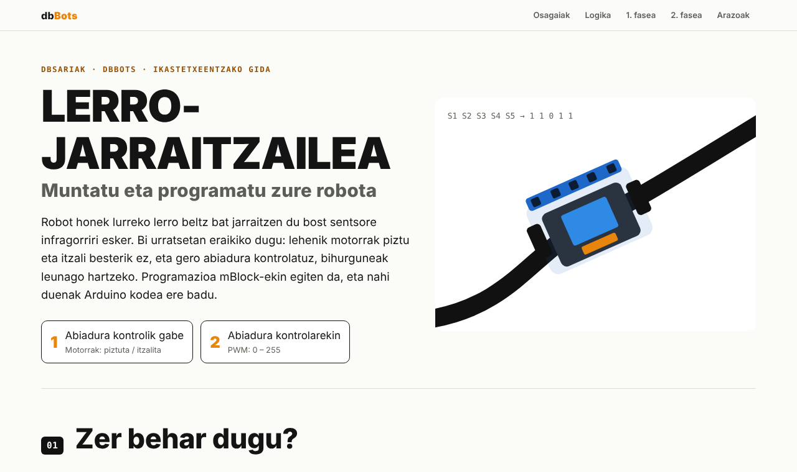
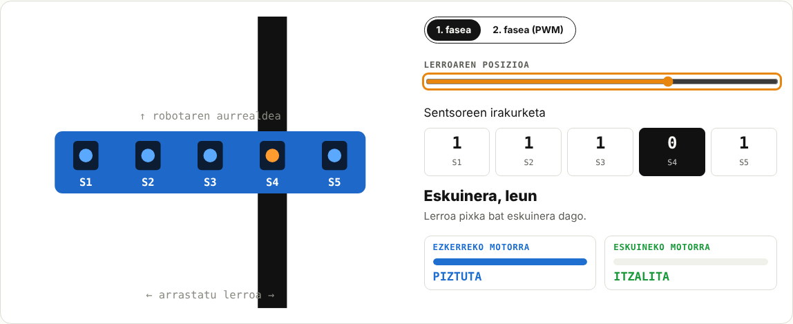
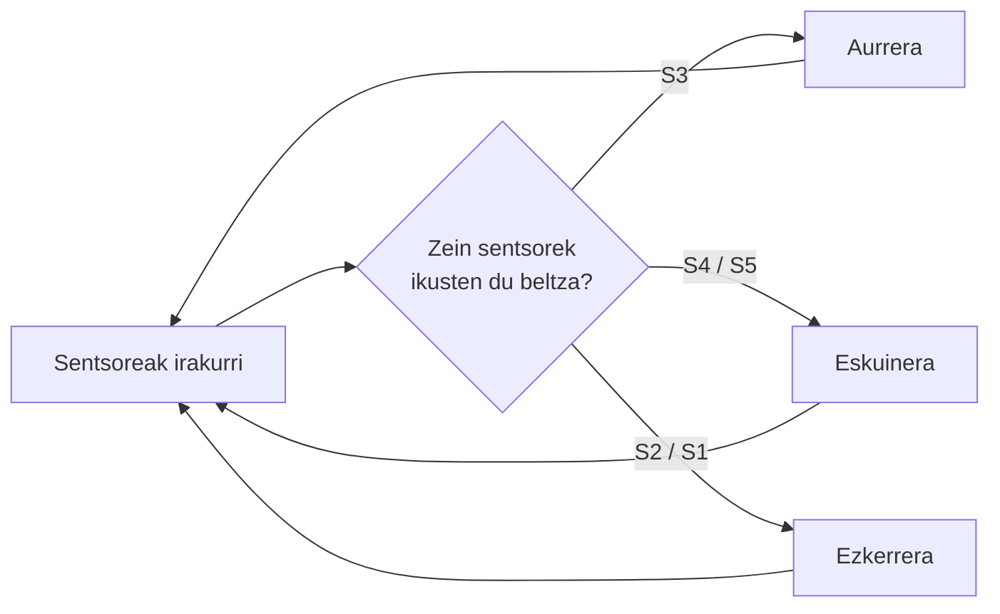

# dbBots · Lerro-jarraitzailea

Lerro-jarraitzaile robot bat muntatzeko eta programatzeko gida, ikastetxeentzat.
**dbSariak**eko **dbBots** ekitaldirako prestatua, Don Bosco-ko Elektronika eta Telekomunikazioak sailak egina.

🌐 **Weba:** https://ERABILTZAILEA.github.io/dbbots-lerro-jarraitzailea/



## Zer dago gidan?

Robotak lurreko lerro beltz bat jarraitzen du bost sentsore infragorriri esker. Bi fasetan eraikitzen da:

| Fasea | Zer egiten du | Motorrak |
|---|---|---|
| **1. fasea** · Abiadura kontrolik gabe | Motorrak piztu eta itzali besterik ez | `HIGH` / `LOW` |
| **2. fasea** · Abiadura kontrolarekin | Bihurguneetan motor bat moteldu egiten da | PWM `0`–`255` |

Webean hauek daude:

- **Osagaiak**: Arduino Uno, L298N motor kontrolatzailea, 5 sentsoreko modulu infragorria, 2 DC motor eta 2 zeldako LiPo bateria.
- **Simulagailua**: lerroa sentsoreen azpian mugitu eta ikusi zer irakurtzen duen Arduinoak eta zer egiten duen motor bakoitzak.
- **Logika**: bost egoeren taula eta fluxu-diagrama.
- **Kableatzea**: eskemak eta konexio-taulak fase bakoitzerako.
- **mBlock programak** blokeetan marraztuta, eta `.mblock` fitxategiak deskargatzeko.
- **Arduino kodea** (aukerakoa), kopiatzeko edo deskargatzeko.
- **Arazoak konpontzen**: ohiko akatsak eta konponbideak.



## Sentsoreen logika

Sentsore batek beltza ikusten badu `0` ematen du, eta zuria ikusten badu `1`. S1 ezkerrekoena da eta S5 eskuinekoena (robota atzetik begiratuta).

| S1 S2 S3 S4 S5 | Egoera | 1. fasea (ezk · esk) | 2. fasea PWM (ezk · esk) |
|---|---|---|---|
| `1 1 0 1 1` | Aurrera | aurrera · aurrera | 255 · 255 |
| `1 1 1 0 1` | Eskuinera, leun | aurrera · geldi | 255 · 150 |
| `1 0 1 1 1` | Ezkerrera, leun | geldi · aurrera | 150 · 255 |
| `1 1 1 1 0` | Eskuinera, gogor | aurrera · geldi | 255 · 0 |
| `0 1 1 1 1` | Ezkerrera, gogor | geldi · aurrera | 0 · 255 |



## Pinak

| Zer | 1. fasea | 2. fasea |
|---|---|---|
| Sentsoreak OUT1…OUT5 | D2…D6 | D2…D6 |
| Ezkerreko motorra (IN1, IN2) | D11, D10 | D13, D12 |
| Eskuineko motorra (IN3, IN4) | D9, D8 | D9, D8 |
| Ezkerreko abiadura (ENA) | jumperra jarrita | D11 (PWM) |
| Eskuineko abiadura (ENB) | jumperra jarrita | D10 (PWM) |

Elikadura: LiPo-aren `+` L298N-aren 12V bornera eta `−` GND-ra. L298N-aren 5V eta GND Arduinoaren 5V eta GND pinetara.

## Fitxategiak

```
dbbots-lerro-jarraitzailea/
├── index.html                  ← weba (orrialde bakarra)
├── .nojekyll                   ← GitHub Pages-ek fitxategiak dauden bezala zerbitzatzeko
├── README.md
├── irudiak/                    ← eskemak, osagaien argazkiak eta pantaila-argazkiak
└── fitxategiak/
    ├── 1-fasea_abiadura_kontrolik_gabe.mblock
    ├── 1-fasea_abiadura_kontrolik_gabe.ino
    ├── 1-fasea_abiadura_kontrolik_gabe.zip
    ├── 2-fasea_abiadura_kontrolarekin.mblock
    ├── 2-fasea_abiadura_kontrolarekin.ino
    └── 2-fasea_abiadura_kontrolarekin.zip
```

- `.mblock` fitxategiak [mBlock 5](https://ide.mblock.cc/)-ekin irekitzen dira (*Fitxategia → Ireki*).
- `.ino` fitxategiak [Arduino IDE](https://www.arduino.cc/en/software)-ekin irekitzen dira.

## GitHub Pages-en argitaratu

1. Sortu biltegi berri bat GitHub-en, adibidez `dbbots-lerro-jarraitzailea` izenarekin, **Public** gisa.
2. Igo karpeta honetako eduki guztia biltegiaren erroan (`index.html` erroan geratu behar da):
   - **Nabigatzailetik:** *Add file → Upload files*, arrastatu fitxategi eta karpeta guztiak eta sakatu *Commit changes*.
   - **Terminaletik:**
     ```bash
     git init
     git add .
     git commit -m "dbBots lerro-jarraitzailearen weba"
     git branch -M main
     git remote add origin https://github.com/ERABILTZAILEA/dbbots-lerro-jarraitzailea.git
     git push -u origin main
     ```
3. Biltegian, joan *Settings → Pages* atalera.
4. *Build and deployment* atalean aukeratu **Deploy from a branch**, adar gisa `main` eta karpeta gisa `/ (root)`. Sakatu *Save*.
5. Minutu bat edo bi barru weba helbide honetan egongo da: `https://ERABILTZAILEA.github.io/dbbots-lerro-jarraitzailea/`
6. Aldatu README honen hasierako esteka zuen benetako helbidearekin.

> `.nojekyll` fitxategia ez ezabatu: horri esker GitHub Pages-ek fitxategi guztiak dauden bezala zerbitzatzen ditu.

## Lokalean probatu

Ez ireki `index.html` bikoitza klik eginez: horrela nabigatzaileak ez du Arduino kodea kargatzen. Erabili zerbitzari txiki bat:

```bash
python3 -m http.server 8000
```

eta ireki `http://localhost:8000`.

## Weba aldatu

- **Testuak eta atalak**: `index.html` fitxategian daude, euskaraz.
- **Kodea**: aldatu `fitxategiak/` karpetako `.ino` fitxategiak. Webak hortik irakurtzen du kodea, ez da HTMLa ukitu behar.
- **Egoerak eta abiadurak** (simulagailua, taula eta blokeak): `index.html`-eko `CASES` zerrendan daude.
- **mBlock programa** aldatzen baduzu, gogoratu `.zip` fitxategia ere berriz sortzeaz:
  ```bash
  cd fitxategiak
  zip 1-fasea_abiadura_kontrolik_gabe.zip 1-fasea_abiadura_kontrolik_gabe.mblock 1-fasea_abiadura_kontrolik_gabe.ino
  ```

## Kanpoko liburutegiak

Webak Internetetik kargatzen ditu letra-tipoak ([Google Fonts](https://fonts.google.com/)) eta fluxu-diagrama marrazteko [Mermaid](https://mermaid.js.org/). Konexiorik gabe orrialdeak funtzionatzen du, baina diagrama ez da marrazten.

## Segurtasuna

LiPo bateriak kontuz erabili: kargatu beti LiPo kargagailuarekin eta begiratuta, ez utzi guztiz deskargatzen, eta ez erabili kolpatuta edo puztuta badago. Informazio gehiago: [LiPo baterien segurtasuna](https://erlerobotics.gitbooks.io/erle-robotics-erle-copter/content/en/safety/lipo.html).

---

dbSariak · dbBots · Don Bosco — Elektronika eta Telekomunikazioak
